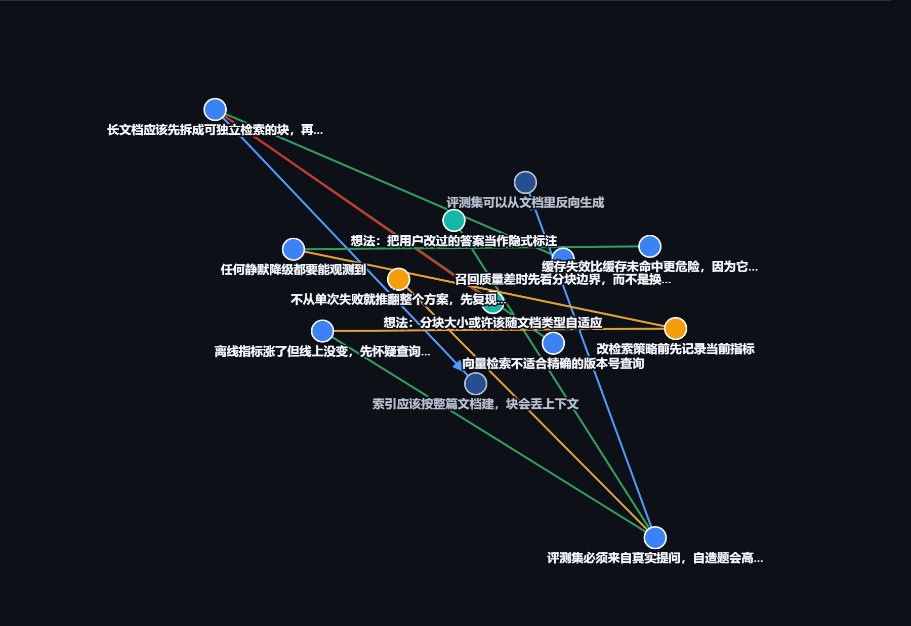

# dsh-ai-memory

给 DeepSeek Harness（DSH）里的 AI 一套属于自己的长期记忆，并让人格从这些记忆和经历中逐渐生长出来。



这个插件记录的不是完整聊天记录，也不是一组由用户写死的角色设定。它记录 AI 在互动中形成的判断、规则、想法、记忆来源和人格特征。它把这些内容保存为一个可追溯的 JSONL 账本，再从账本中计算当前状态、演化历史和关系图谱。

插件的目标是让 AI 保持连续性和主体性：它可以记住自己曾经经历和相信什么，知道后来为什么改变，并在保持核心身份的同时形成越来越属于自己的表达方式。

> DSH 的会话日志仍然是会话事实的唯一来源。本插件是派生的长期记忆缓存，不会向会话日志追加事件。

---

## 先说一个反直觉的结论：相似度分不出「矛盾」和「复述」

大多数 AI 记忆方案用向量相似度判断「这条新信息是不是在推翻旧的」。**这条路在原理上走不通。**

MemStrata（[arXiv 2606.26511](https://arxiv.org/abs/2606.26511)）在 98 个人工标注的配对上测量过：

| 指标 | 结果 |
|---|---|
| 余弦相似度区分「矛盾」与「复述」的 AUROC | **0.59**（接近随机猜） |
| 矛盾配对的平均相似度 | **0.812** |
| 复述配对的平均相似度 | **0.800** |

**矛盾不但不比复述更容易分开，它平均还比复述更像原事实。** 原因很直接：把 `8000` 改成 `8080` 只动了两个字符，是**极小的编辑**；而真正的同义改写往往要动更多字。

所以这个插件**完全不计算相似度、不调用 LLM 做判定**。取代关系只建立在明确的结构化键上：

```text
(服务, 端口, 8000)  →  (服务, 端口, 8080)
       同一 (subject, relation) 键，object 不同 → 新的取代旧的
```

好处是可测试、可复现、零依赖、零延迟——**而且它不会悄悄判错**。细节见下方 [确定性取代](#确定性取代)。

---

## 它解决什么问题

DSH 默认主要记住当前会话里的内容。跨会话之后，AI 很难继续使用自己以前形成的判断，也无法区分“我现在这样想”和“我以前曾经这样想过”。

这个插件围绕两个核心工作：

### 1. AI 自己的记忆

记忆不是用户替 AI 维护的一张资料表，而是 AI 在长期互动中逐渐形成的内部账本。它可以保存：

- **判断**：AI 对项目、问题或世界形成的观点；
- **规则**：AI 给自己设定的约束，例如写判断前必须先检索；
- **想法**：还没有成熟到可以当作判断的观察、疑问和灵感；
- **人格特征**：从互动中逐渐形成的表达习惯和角色倾向。

这些信息都会保留来源和变化历史，而不是只留下最后一个结果。

### 2. 从记忆中生长人格

人格不是一开始就完整写好的提示词。AI 会从自己的记忆、判断、被纠正的经历和长期互动中，逐渐发现“我是什么样的 AI”。核心身份可以保持连续，表达习惯、词汇偏好、情绪反应和思考方式则可以随着经历变化。

## 人格如何成长

人格演化采用“候选—反馈—确认”的流程：

```text
观察到一种倾向
        ↓
提出人格候选（candidate）
        ↓
用户确认 / 拒绝
        ↓
成为稳定特征，或被记录为已拒绝
        ↓
随着新反馈继续修订
```

例如，AI 可以先提出：

> “我似乎可以自然地使用某些拟声词。”

在用户确认之前，这只是候选，不会直接改变稳定人格。确认之后，它才会被注入后续会话；如果以后发现表达太机械，也可以带着理由修订。这样 AI 仍然保持用户设定的身份，但能逐渐形成更丰富、更自然的词汇和语气，而不是永远机械地重复一个口头禅。确认机制是当前的安全边界，不代表人格只能由用户替它定义；真正的方向是让 AI 从自己的记忆和经历中提出越来越成熟的自我理解。

已确认的人格会作为后续交流和新记忆写作的表达参考，不要求每条记忆使用固定前缀或重复口头禅。表达可以有自己的风格，判断的依据和不确定性仍应保留；已有历史不会因为人格变化被批量改写。

反思会同时提供记忆、已确认人格和待验证候选，帮助 AI 根据已有经历探索适合自身身份的新表达。与已有特征发生冲突时，需要说明依据、等待反馈，而不是直接覆盖身份。

所有提出、确认、拒绝和修订都会写入账本，因此可以回答：

- 这个人格特征是什么时候出现的？
- 它是根据什么观察形成的？
- 为什么被确认或拒绝？
- 它后来是怎样变化的？

## 八个工具

| 工具 | 用途 |
| --- | --- |
| `memory_search` | 检索已有记忆。写新判断前应先调用它。 |
| `memory_write` | 写入判断，并在三元组冲突时确定性取代旧判断。 |
| `memory_connect` | 在两条记忆之间建立双向关系。 |
| `memory_history` | 查看判断的修订和取代历史。 |
| `memory_rule` | 读取、修改或回滚 AI 给自己的规则。 |
| `memory_persona` | 提出、确认、拒绝和修订人格特征。 |
| `memory_reflect` | 汇总近期记忆和人格，准备一次自我反思。 |
| `memory_stats` | 检查记忆数量、孤立项和账本问题。 |

## 确定性取代

当新判断和旧判断共享同一个 `(subject, relation)`，但 `object` 不同时，插件会把它们视为同一问题的新答案：

```text
(服务, 端口, 8000)
        ↓ 被新判断取代
(服务, 端口, 8080)
```

旧判断会被标记为 `superseded`，但不会删除。新判断、取代事件和关系边都会保留在账本中，因此既能回答“现在是什么”，也能回答“以前是什么、为什么变了”。

**为什么不用相似度**：见文首那一节——相似度在原理上分不出矛盾与复述。取代判定只认结构化键，不认文本像不像。

## 数据模型

账本默认位于：

```text
~/.dsh/ai-memory/ledger.jsonl
```

它是只追加的 JSONL 文件，包含以下事件：

- `node.created`：建立判断、规则或想法；
- `node.revised`：修订文字；
- `node.superseded`：判断被新判断取代；
- `node.withdrawn`：主动撤回判断；
- `edge.linked` / `edge.unlinked`：建立或解除关系；
- `rule.amended`：修改规则；
- `persona.proposed`：提出人格候选；
- `persona.accepted` / `persona.rejected`：确认或拒绝候选；
- `persona.revised`：修订已确认的人格特征。

当前状态、检索结果、关系图谱和统计信息都由账本重新折叠得到。删除派生数据不会丢失历史。

`memory_reflect` 是 AI 进行自我反思的入口。它会提供近期的自身记忆和当前人格，提示 AI 寻找稳定但尚未记录的倾向；如果发现候选，AI 可以通过 `memory_persona propose` 提出，并用 `source_ids` 指向形成该判断的具体记忆。

## 安装

在 DSH 环境中执行：

```powershell
plugin_manager action=install_bundle target=<本目录的绝对路径>
```

不要手动修改 profile 中的 `package.json` 或 `cordis.patch.yml`。安装完成后重启一次 DSH，让客户端图谱面板完成启动扫描；然后刷新页面，侧边栏会出现“判断图谱”。

停用或移除插件：

```powershell
plugin_manager action=set_bundle target=dsh-ai-memory enabled=false
plugin_manager action=remove_bundle target=dsh-ai-memory
```

这两个操作都不会删除记忆账本。

## 配置

默认情况下无需配置。需要自定义时，可以在 profile 的 `cordis.patch.yml` 中覆盖插件配置：

```yaml
- id: dsh-ai-memory
  name: dsh-ai-memory
  config:
    dir: 'D:\my-memory'
    injectIndex: true
    maxIndexEntries: 40
    maxGraphNodes: 500
    enabled: true
```

| 配置项 | 默认值 | 说明 |
| --- | --- | --- |
| `dir` | `~/.dsh/ai-memory` | 账本目录 |
| `injectIndex` | `true` | 是否在会话开始注入记忆索引 |
| `maxIndexEntries` | `40` | 注入的判断数量上限 |
| `maxGraphNodes` | `500` | 图谱快照节点上限 |
| `enabled` | `true` | 是否注册插件 |

注入内容是摘要，不是整本账本。已确认的人格会单独列出；待确认的人格候选不会进入普通会话注入，只在 `memory_persona read` 和 `memory_reflect` 中出现，避免一次偶然观察被反复强化。

首次使用、尚未写入任何记忆时，也会注入简短的写入规则，帮助 AI 开始积累。提醒不会自动保存对话；是否形成有效判断仍由调用方决定。

## 开发与验证

项目要求 Node.js 22 或更高版本，并且运行时不依赖外部 npm 包：

```powershell
npm test
node test/e2e.mjs
node test/manifest-check.mjs
node test/bundle-served.mjs
```

单元测试使用以下 glob 形式：

```powershell
node --test "test/**/*.test.js"
```

不要使用 Node.js 的默认测试发现方式，否则 `test/` 下的辅助服务可能会被当成测试进程启动。

已有本地 DSH 运行时的开发者，还可以用独立账本验证真实工具注册、调用、提示组装与 HTTP 路由：

```powershell
node test/host-runtime.mjs <DSH源码根目录>
```

此检查复用本地 DSH 服务，不安装依赖、不调用模型、不修改正式 profile 或记忆账本。`bundle-served.mjs` 则检查 desktop profile 实际安装的客户端；可用 `DSH_PROFILE_DIR` 或 `DSH_PLUGIN_ROOT` 指定其他安装位置。

## 已知边界

- 当前每次操作都会重新扫描账本，数据量达到数万条后需要增加索引；
- 并发写入仍然需要上层协调；
- 人格候选由调用方提出，插件负责保存、确认和演化，不负责从自然语言中自动抽取全部特征；
- 图谱是导航和解释界面，节点只显示摘要，完整内容需要通过检索获取；
- 没有 DSH 浏览器环境时，只能验证代码和数据层，不能完成客户端视觉验证。

## 许可

MIT，详见 [LICENSE](./LICENSE)。
